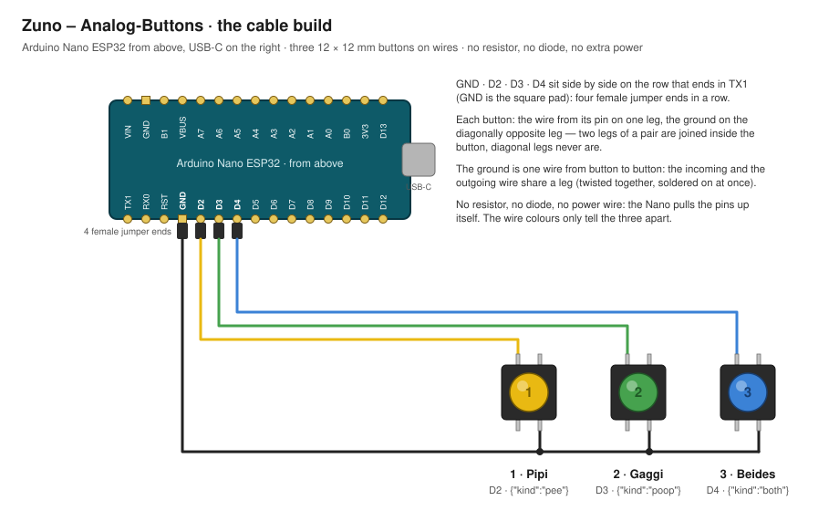

# Zuno – Analog-Buttons: real buttons for the changing table

A small Wi-Fi microcontroller with push buttons that logs a diaper (or any
other entry) into Zuno with one press — no phone needed. The sketch in
`zuno-analog-buttons/` is written for the **Arduino Nano ESP32**; any ESP32
board with Wi-Fi works with other pin names.

End-to-end encryption holds all the way: a press is sealed **on the device**
with a key the server never sees. The server stores a blob it cannot read,
and the next phone of the family that syncs turns it into the entry, signed
with the device's name.

This folder has three parts:

- **The sketch** — the firmware, finished and in use.
- **The build** — the Nano and three 12 × 12 mm buttons with coloured caps,
  joined by nothing but wires: the version for the changing table.
- **A proof of concept on a breadboard** — the first rig, a dev board
  pressed into a breadboard with loose 6 × 6 mm buttons: the quickest way
  to try the whole path, not a thing to mount anywhere.

## How it works

- **One device = one board.** The app registers a device and names it (the
  name signs every entry the device makes); which physical button logs what
  is set in the sketch. A board may carry up to three buttons — one entry
  each — and a pin without a button simply never fires.
- **The device code** from the app (96 hex characters) is the token (32
  hex) followed by the key (64 hex). The server knows the token only as a
  hash and checks it on every press; the key never leaves the device and
  the family's phones.
- **A press** is `{"v":3,"at":"<UTC>","type":"diaper","details":{…}}`,
  padded with spaces to 128 bytes (so a «Pipi» and a «Gaggi» have the same
  length on the wire), encrypted with AES-256-GCM (hardware-accelerated on
  the ESP32; AAD `bt1|device`, a random 12-byte IV) and posted as
  base64url(`0x03` ‖ iv ‖ ciphertext ‖ tag) to `POST /api/devices/events`
  together with the token — no cookie, no account.
- **The time** comes from Zuno's own server: a `HEAD` on `ZUNO_URL` and its
  `Date` header, at boot and every six hours. No time server, no third
  party. A press made before the clock is known keeps its true time (the
  device remembers how long ago it was pressed). A phone refuses a press
  whose time is in the future or older than a week.
- **TLS:** presses are verified against `root_ca.h` (ISRG Root X1, the root
  behind Let's Encrypt). A host with another certificate authority: paste
  that root there. The clock request alone runs without the check — a
  certificate cannot be judged before the clock is known, and that request
  carries nothing.
- **Offline:** up to 16 presses wait in memory while the Wi-Fi is down and
  go out in order once it is back; a reboot loses what is waiting. The
  network work runs in a task of its own, so the buttons are read all the
  time — two quick presses in a row both arrive.
- **Limits** (the server's): 60 presses an hour per address, 200 unread
  presses per family, 10 devices per family. A `404` means the device was
  removed in the app; a `429`, the hourly budget.

## The sketch

`zuno-analog-buttons/zuno-analog-buttons.ino` and `root_ca.h` belong
together. Only the block at the top is yours to change:

```cpp
const char* WIFI_SSID = "your-wifi";
const char* WIFI_PASS = "your-wifi-password";
const char* ZUNO_URL  = "https://example.ch/baby";  // the address you open on the phone, no trailing slash
const char* ZUNO_CODE = "";                         // from Mehr › Einstellungen › Analog-Buttons

const char* OTA_PASSWORD = "";                  // updates over Wi-Fi; empty = USB only
const char* OTA_NAME     = "zuno-wickeltisch";  // the board's name on the network

Button BUTTONS[] = {
  { D2, "diaper", "{\"kind\":\"pee\"}" },   // button 1: Pipi
  { D3, "diaper", "{\"kind\":\"poop\"}" },  // button 2: Gaggi
  { D4, "diaper", "{\"kind\":\"both\"}" },  // button 3: Beides (the pin may stay empty)
};
```

Each button is a pin and the entry a press makes. `details` is what Zuno
stores for that type (see `src/validate.js`): a diaper `{"kind":"pee"}`,
`{"kind":"poop"}` or `{"kind":"both"}`; a bottle `{"amount_ml":90}`; a
medication `{"name":"Vitamin D"}`; a sleep timer `{}` (a second sleep press
while one runs is refused by the phone). Swap a pin or a kind there.

### Getting it onto the board

1. Install the Arduino IDE 2 and, under **Tools › Board › Boards Manager**,
   the package **Arduino ESP32 Boards**.
2. **Make a sketch of your own — do not edit the repository's file.** In the
   IDE: **File › New Sketch**, paste the whole of `zuno-analog-buttons.ino`
   into it, then add a tab named `root_ca.h` (the tab bar's menu, the three
   dots on the right › New Tab) and paste that file in too. The IDE keeps
   your sketch in its own folder; the file in the repository stays clean —
   your Wi-Fi password and your device code must never end up in the
   source.
3. In the app: Mehr › Einstellungen › Analog-Buttons › «Analog-Buttons
   hinzufügen», give the device a name («Wickeltisch»), «Code kopieren».
4. Fill in the four values in your sketch (the code between the quotes;
   spaces are fine). Set an `OTA_PASSWORD` too if later versions should
   go on over Wi-Fi (next section) — this first upload is over USB either
   way.
5. Connect the board over USB-C, choose **Tools › Board › Arduino ESP32
   Boards › Arduino Nano ESP32** and the board under **Tools › Port**, then
   **Upload**.
6. **Tools › Serial Monitor**, 115200 baud. The sketch greets every newly
   connected monitor with a `[boot]` summary (code, Wi-Fi, clock, waiting
   presses, the last reset's reason, every button's pin and current state);
   then `[wifi]`, `[clock] …` (the time from the server) and, on a press,
   `[btn]`, `[press] …` and `[send] 201 {"ok":true}`.

The device is now registered; a press appears on both phones with the next
sync (within a minute while the app is open). «Testdruck senden» in the app
sends one press without the hardware — the same bytes the sketch sends — to
prove the path.

### Updating over Wi-Fi

With an `OTA_PASSWORD` in the sketch, the board needs the cable only once.
Every later change — another device code, another `ZUNO_URL`, a button
moved to another pin — goes over Wi-Fi:

1. The board is running and on the Wi-Fi; your Mac is on the same network.
   The serial monitor's greeting says `Update über WLAN: bereit als
   zuno-wickeltisch (192.168.…)`.
2. In the IDE, **Tools › Port** lists it under network ports as
   «zuno-wickeltisch at 192.168.…». Pick it.
3. **Upload.** The IDE asks for the password (`OTA_PASSWORD`). The blue LED
   flickers while the program arrives (about half a minute), then the board
   restarts into the new version.

Keep the same `OTA_PASSWORD` in the new version, or the next update needs
the cable again. During the update the buttons are not read, and presses
still waiting (red LED on) are lost with the restart — update while the
red LED is off. A wrong password is refused (`[ota] failed … wrong
password`) and the old program keeps running; so does a broken transfer.

### The LEDs (Nano ESP32)

| LED | Meaning |
| --- | --- |
| green, steady | the board's power LED — always on, not the sketch's |
| green blink | a press was taken, or a press was sent |
| blue | sending |
| blue flickering | an update is arriving over Wi-Fi |
| red on | presses are waiting (no Wi-Fi, no clock yet) |
| red blink ×1 | a send failed, will be retried (backing off up to five minutes) |
| red blink ×2 | the queue is full (16 waiting), the press was dropped |
| red blink ×3 | the server refused the press for good — see the serial monitor |
| red flashing | `ZUNO_CODE` is not a device code |

## The build: buttons on wires

No breadboard and no circuit board: the Nano keeps its header pins, each
button hangs on two wires, and four wires end on the Nano — one per button
and one ground that all buttons share. That is the whole circuit: no
resistor, no diode, no power for the buttons. The Nano pulls its input
pins up internally; a pressed button pulls its pin to ground, and that is
the signal. A pin without a button stays up and never fires, so two
buttons are fine with the three lines in the sketch.



The same as text — the Nano from above, the USB-C connector to the right,
the pin row that ends in TX1:

```
   TX1 RX0 RST GND D2  D3  D4  D5  D6  D7  D8  D9  D10 D11 D12
                │  │   │   └─────────────────────────────────┐
                │  │   └───────────────────────┐             │
                │  └─────────────┐             │             │
                │              ┌─┴─┐         ┌─┴─┐         ┌─┴─┐
                │              │ 1 │ Pipi    │ 2 │ Gaggi   │ 3 │ Beides
                │              └─┬─┘         └─┬─┘         └─┬─┘
                └────────────────┴─────────────┴─────────────┘
                    one ground wire, from button to button (two wires on one leg)
```

### Parts

- An Arduino Nano ESP32 with male headers soldered
- Three 12 × 12 × 7.3 mm tactile buttons with round coloured caps — sold
  as sets of 25 in five colours for a few francs; the 6 × 6 mm buttons of
  the proof of concept work exactly the same, they are just fiddly to
  solder and to mount
- Two female–female jumper wires (Dupont, 20–30 cm): cut in half they give
  the four ends for the Nano's pins, each with a bare wire to solder
- A piece of thin stranded wire (0.14–0.25 mm², 24–26 AWG — or more cut-up
  jumpers) for the ground from button to button and for any longer run
- Heat-shrink tubing (or tape), a soldering iron, a USB-C cable and a USB
  power supply (any phone charger)

### The legs of a 12 × 12 button

Four legs, two out of each of two opposite sides — 5 mm apart on a side,
12.5 mm across. Two of them are joined inside the button; a press joins
the other two to them. Which two is not visible, so the rule is the same
as on the breadboard: **solder to two diagonally opposite legs** — they
are never a joined pair, whichever way the button is turned. The picture
shows it: the pin's wire on the upper left leg, the ground on the lower
right.

The caps are pushed onto the square stem and come off again, so which
colour means what is yours to decide — the sketch knows only pins. The
picture has yellow for Pipi, green for Gaggi, blue for Beides.

### Wiring

The four pins **GND, D2, D3, D4** sit side by side on the Nano, in the row
that ends in RST / RX0 / TX1 — GND is the one with the square pad. Four
female ends in a row; only their order can go wrong.

| Wire | from | to | what for |
| --- | --- | --- | --- |
| 1 | **GND** (square pad, beside D2) | button 1, one leg | the ground |
| 2 | the same leg of button 1 | button 2, one leg | the ground goes on |
| 3 | the same leg of button 2 | button 3, one leg | the ground goes on |
| 4 | **D2** | button 1, the **diagonal** leg | button 1 = Pipi |
| 5 | **D3** | button 2, the diagonal leg | button 2 = Gaggi |
| 6 | **D4** | button 3, the diagonal leg | button 3 = Beides |

Two wires on one leg: the incoming and the outgoing ground share the leg —
twist the two bare ends together and solder them to the leg at once; no
junction, no splice. With two buttons, wires 3 and 6 are left out and D4
stays empty.

Soldering: tin the leg and the wire first, then hold them together and
touch the joint with the iron for a second. Slide a piece of heat-shrink
over every joint: the neighbouring leg is only 5 mm away, and a bare joint
touching it reads as a button held down. Then the strain relief — a press
pulls on the wires a little, every day: fix the wires to the button's body
with a cable tie or a dab of hot glue a centimetre behind the joints, so
the solder never carries the pull. The same at the Nano: the female ends
hold by friction only; a cable tie around the board or a dab of hot glue
keeps them on.

The wires can be a few metres long: a pulled-up pin and the sketch's 40 ms
debounce shrug off a blip. On a long run keep the ground wire together
with the pin wires, twisted loosely, rather than routing it apart.

### Mounting

The caps want a hole their size in a lid, a strip of wood or the table's
edge, with the body held behind on hot glue or a dab of epoxy. The Nano
lives in its own small box wherever the USB-C cable reaches a charger —
away from the wet side of the table. Nothing on the device needs to be
reached once it runs: the LEDs are for the first test, after that the
Verlauf on the phone says whether a press arrived.

## Proof of concept on a breadboard

A test rig, not a product: a dev board pressed into a breadboard, loose
tactile buttons, jumper wires. It proves the whole chain — button, device,
server, phones — in an afternoon, and it is the quickest way to try a
different pin or entry type before soldering anything. The sketch is the
same as in the build.

### Parts

- An Arduino Nano ESP32 with male headers soldered (pins pointing down)
- Up to three tactile buttons with four legs — 6 × 6 mm ones, or the
  12 × 12 mm ones of the build (two are enough to start)
- A half-size breadboard (30 columns, rows a–j, two power rails) and a
  handful of male–male jumper wires
- A USB-C cable

Before you start: take the Nano out of the black foam it ships in. That
anti-static foam is conductive and ties every pin to every other — never
power the board in it.

### The button's legs

A 6 × 6 tactile button has four legs, two of them joined inside; pressing
connects the two pairs. Which two legs form a pair is not visible. The safe
rule: **always use two diagonally opposite legs** — they are never in the
same pair, whichever way the button is turned.

```
   button from above, four legs:

     1 ─┬────────┬─ 2
        │   ( )  │
     3 ─┴────────┴─ 4

   use 1 and 4 (or 2 and 3) — diagonal
```

The button must straddle the breadboard's centre channel. A breadboard
joins the five holes a–e of a column and, separately, f–j. A button sitting
entirely on one side would have two of its legs joined by the board itself
— and if those are the two the button is meant to connect, it reads as
pressed all the time. Across the channel the board joins nothing the
button does not join itself. These buttons are made for circuit boards:
their leg pitch (6.5 × 4.5 mm) does not quite match the breadboard's
(7.62 × 5.08 mm), so they hold only with slightly spread legs and firm
pressure. Straighten the legs with small pliers if they are kinked, push
the button in until it seats, and check that it does not wobble.

The 12 × 12 buttons of the build sit better: their legs are 5 mm apart on
a side and 12.5 mm across — two columns, and exactly the span from row d
to row g. Put such a button across the channel with its legs in rows
**d** and **g** instead of e and f, two columns apart as before; the wires
of the table below land in the same holes (a20 reaches row d, j22 reaches
row g).

### The Nano on the breadboard

Lay the breadboard with the numbers 1–30 left to right, row a at the
bottom, row j at the top, the channel between e and f. The Nano straddles
the channel with **its USB-C connector hanging over the left edge** (before
column 1):

- The pin row with **D2, D3, D4, GND** (the one ending in RST / RX0 / TX1)
  goes into row **f**, directly above the channel. Four free holes (g–j)
  remain above every pin: that is where the buttons connect.
- The other row (D13, 3V3, A0 … GND, VIN) then lands in row **b**, with one
  free hole (a) below every pin.

So D12 sits in column 1 and the columns count up:

```
 column:  1   2   3   4   5   6   7   8   9  10  11  12  13  14  15
 row f:  D12 D11 D10  D9  D8  D7  D6  D5  D4  D3  D2 GND RST RX0 TX1
 row b:  D13 3V3  B0  A0  A1  A2  A3  A4  A5  A6  A7 VBUS B1 GND VIN
                                           ─┘  ─┘  ─┘ └─ everything connects here
```

GND exists twice, both with a square pad: in the top row between D2 and
RST (column 12) and in the bottom row between B1 and VIN (column **14** —
VIN is the last pin, column 15). The bottom one is the handier for the
minus rail: its free hole a14 sits right next to the rail. Do not mix them
up: a15 is VIN, the power input, and must never touch the minus rail.

### Wiring

Each button straddles the channel like the Nano: two legs in row e, two in
row f, two columns apart — button 1 in columns 20 and 22, button 2 in 24
and 26, button 3 in 28 and 30. From the leg in row e a wire goes down to
the minus rail, from the **diagonal** leg in row f a wire goes up to the
pin:

| Wire | from | to | what for |
| --- | --- | --- | --- |
| 1 | **a14** (below the bottom row's GND, between B1 and VIN) | bottom minus rail (–) | common ground |
| 2 | **a20** (button 1, leg in row e, column 20) | minus rail (–) | button 1 to ground |
| 3 | **j22** (button 1, diagonal leg in row f, column 22) | **j11** (above D2) | button 1 = Pipi |
| 4 | **a24** (button 2, leg in row e) | minus rail (–) | button 2 to ground |
| 5 | **j26** (button 2, diagonal leg in row f) | **j10** (above D3) | button 2 = Gaggi |
| 6 | **a28** (button 3, leg in row e) | minus rail (–) | later: button 3 to ground |
| 7 | **j30** (button 3, diagonal leg in row f) | **j9** (above D4) | later: button 3 = Beides |

That is all: no resistor, no diode, no power for the buttons. The Nano
pulls the pins up internally; a pressed button pulls its pin to ground,
and that is the signal. A pin without a button stays up and never fires,
which is why the three lines may stay in the sketch while only two buttons
are wired. The minus rail is one long strip on a half-size board: any hole
of it will do (on a full-size board the rails are often split in the
middle — a gap in the printed line shows it). The plus rail stays empty.

As a picture (row j at the top, a at the bottom; `●` = a button leg, `[1]` …
`[7]` = the wires of the table, at both ends):

```
 column:    1   2   3   4   5   6   7   8   9  10  11  12  13  14  15    20  22    24  26    28  30
 row j      ·   ·   ·   ·   ·   ·   ·   ·  [7] [5] [3]  ·   ·   ·   ·     ·  [3]    ·  [5]    ·  [7]
 row i      ·   ·   ·   ·   ·   ·   ·   ·   ·   ·   ·   ·   ·   ·   ·     ·   ·     ·   ·     ·   ·
 row h      ·   ·   ·   ·   ·   ·   ·   ·   ·   ·   ·   ·   ·   ·   ·     ·   ·     ·   ·     ·   ·
 row g      ·   ·   ·   ·   ·   ·   ·   ·   ·   ·   ·   ·   ·   ·   ·     ·   ·     ·   ·     ·   ·
 row f     D12 D11 D10  D9  D8  D7  D6  D5  D4  D3  D2 GND RST RX0 TX1    ●   ●     ●   ●     ●   ●
 ─────────────────────────────── channel ───────────────────────────────────────────────────────────
 row e      ·   ·   ·   ·   ·   ·   ·   ·   ·   ·   ·   ·   ·   ·   ·     ●   ●     ●   ●     ●   ●
 row d      ·   ·   ·   ·   ·   ·   ·   ·   ·   ·   ·   ·   ·   ·   ·     ·   ·     ·   ·     ·   ·
 row c      ·   ·   ·   ·   ·   ·   ·   ·   ·   ·   ·   ·   ·   ·   ·     ·   ·     ·   ·     ·   ·
 row b     D13 3V3  B0  A0  A1  A2  A3  A4  A5  A6  A7 VBUS B1 GND VIN    ·   ·     ·   ·     ·   ·
 row a      ·   ·   ·   ·   ·   ·   ·   ·   ·   ·   ·   ·   ·  [1]  ·    [2]  ·    [4]  ·    [6]  ·
 minus (–) ═[1]═══════════════════════════════════════════════════════[2]═══════[4]═══════[6]═══
 ◄ the USB-C connector hangs over this edge
```

Wires 3, 5 and 7 run along row j from the buttons left to D2, D3 and D4;
wires 1, 2, 4 and 6 run down to the minus rail. Nothing crosses the Nano.
The buttons' columns are suggestions; what matters is: a button across the
channel, one leg to minus, the diagonal leg to the pin.

## Trying it out

Press button 1: the green LED blinks once (press taken), blue for a moment
(sending), green again (confirmed). Within a minute «Windel · Pipi» with
the device's name is in the Verlauf of both phones — the app must be open,
it fetches the presses when it syncs. Red on means presses are waiting
(no Wi-Fi or no clock yet); red ×3 means the server refused, and the serial
monitor says why.

## Troubleshooting

- **"Bad CPU type in executable" … `esptool` … "exit status 126"** (Mac
  with an Apple chip): the board package's `esptool` is an Intel binary
  and Rosetta 2 is missing. Run
  `softwareupdate --install-rosetta --agree-to-license` once in the
  Terminal (it asks for your Mac password), then upload again — nothing
  needs reinstalling. The message is shown under "Compilation error" but
  has nothing to do with the sketch.
- **The Nano does not take the upload** (the port vanishes, "no device
  found"): press RST on the board twice quickly — the LED pulses, the Nano
  waits for firmware — then pick the new entry under Tools › Port and
  upload again.
- **The board is not listed under network ports:** `OTA_PASSWORD` is empty
  in the program that runs (the greeting says `Update über WLAN: aus`), the
  board is not on the Wi-Fi yet, or the Mac is on another network — a guest
  Wi-Fi usually keeps its devices apart. Reopen the Tools menu after a few
  seconds; the IDE looks for the board by name on the local network.
- **`root_ca.h: No such file`**: the second tab is missing in your sketch
  (step 2 above).
- **It works once, then no more — or only while pressing on the Nano:** a
  loose contact. On the breadboard the Nano is not seated firmly: the USB
  cable's weight tilts it a little and the pins lose contact with the
  breadboard's springs — push the Nano in to the stop and route the cable
  so it does not hang on the connector (a rubber band or cable tie on the
  board, a bend in the cable on the table). On wires it is a female end
  sitting loose on its pin, or a solder joint that only looks joined: push
  the end on to the stop, tug every joint once.
- **Nothing blinks, nothing in the serial monitor:** set the monitor to
  115200 baud and press RST on the Nano, or close and reopen the monitor —
  the sketch greets every newly connected monitor with `[boot] …` and one
  line per button («Pin 2, diaper … liest gerade offen»). What was printed
  before the monitor connected is discarded by the USB port. «Code
  FEHLT/ungültig» means `ZUNO_CODE` is wrong. A button reading «GEDRÜCKT»
  with nobody pressing has two legs of the same pair wired — take the
  diagonal leg. No `[press]` on a press: bridge the button — hold a wire
  from D2 to GND for a moment (on the breadboard: from j11, above D2, to
  the minus rail). If `[press]` appears now, the fault is the button or
  its legs; if not, the wire to D2 or the ground (on the breadboard: is
  the Nano really seated with D2 in column 11?).
- **A button fires by itself, or when its wire is touched:** a bare solder
  joint touching the neighbouring leg, 5 mm away (heat-shrink every
  joint), or a long run picking up noise — keep the ground wire together
  with the pin wires, twisted loosely.

## Security notes

Whoever has the device code can make entries for the family (not read
them: the code opens nothing the server stores). Keep your sketch with the
code to yourself; remove the device in the app if the board is lost — its
token stops working at once. The Wi-Fi password is in your sketch too.

With `OTA_PASSWORD` set, anyone on your Wi-Fi who knows that password can
put another program on the board — choose a long one, not the Wi-Fi
password. The password itself never crosses the network (the board asks
for proof of it), but the uploaded program does, unencrypted, and it holds
your Wi-Fi password and the device code: update from your own network,
never over a shared one. An empty `OTA_PASSWORD` switches updates over
Wi-Fi off.
